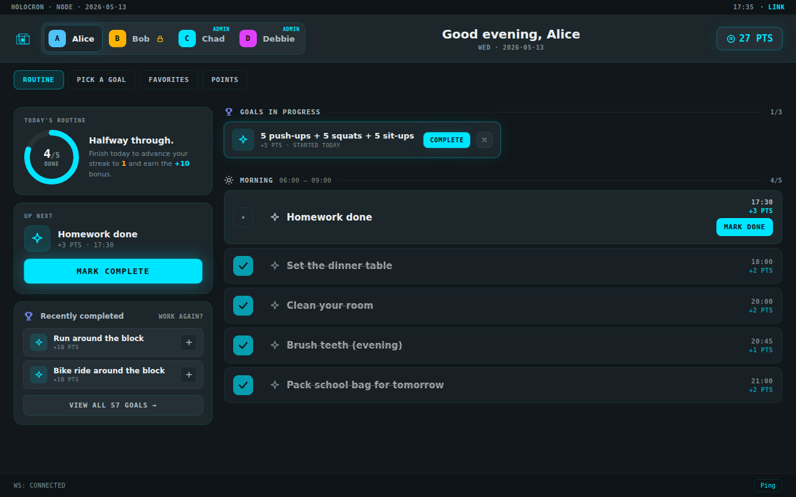
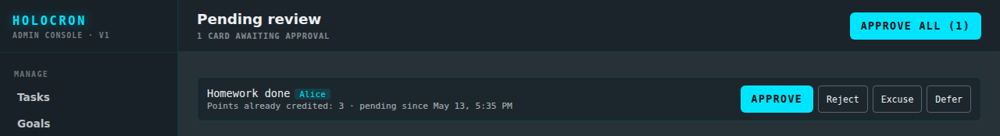
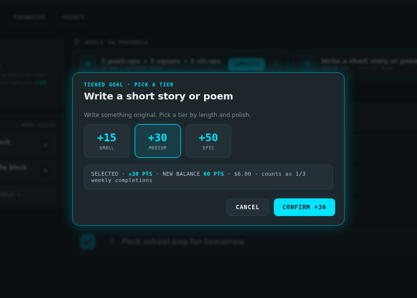
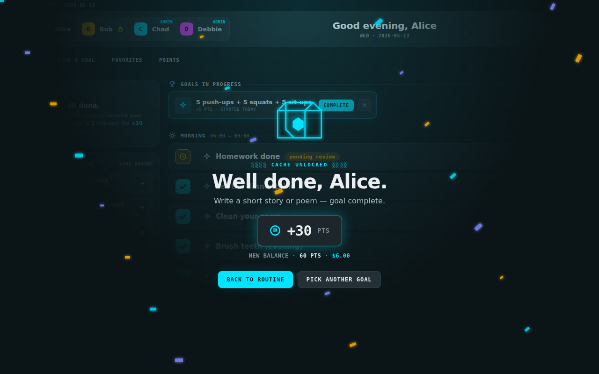
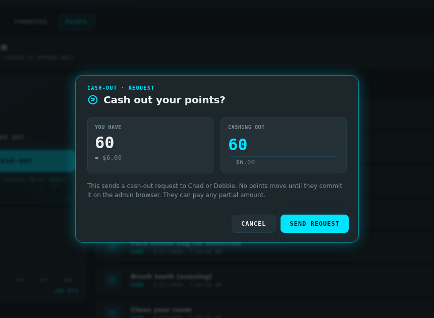
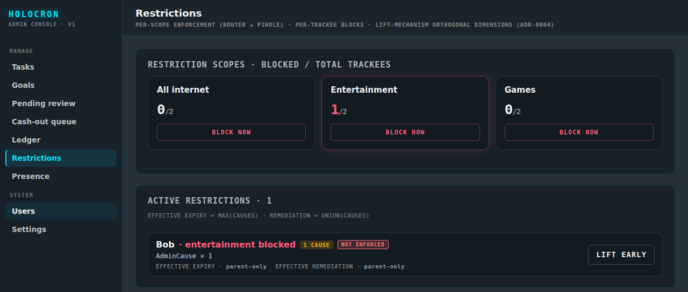
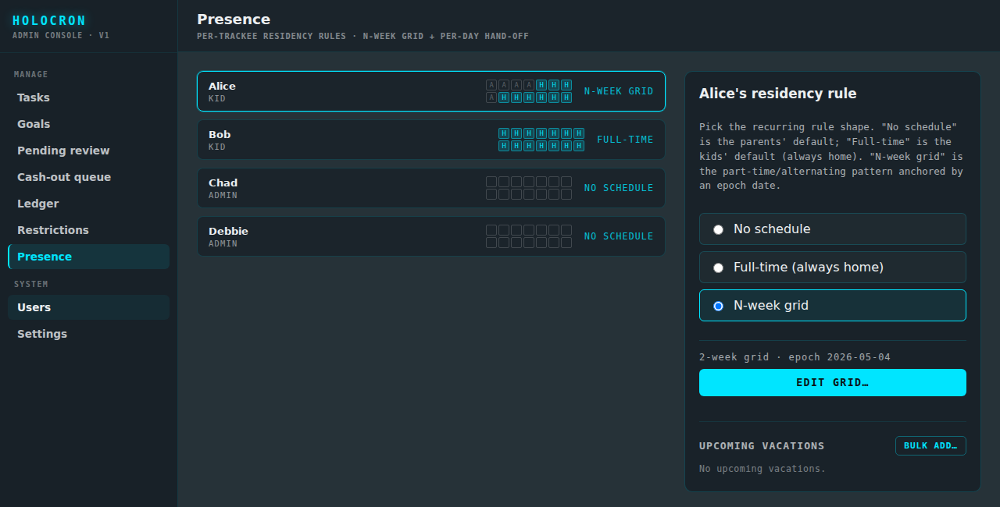
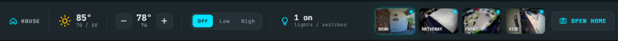
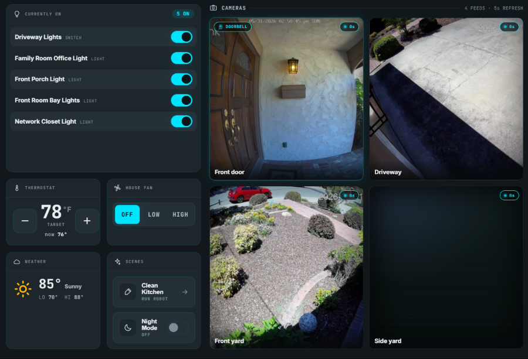

# Holocron

A self-hosted wall-tablet app for a household's daily routines. Kids check off tasks for points, spend them on goals you set, and lose internet, streaming or games access at the router when they miss tasks.


**Jump to:** [Daily routine](#the-daily-routine) · [Review and approve](#review-and-approve) · [Goals](#goals-and-tiers) · [Cash-out](#cash-out) · [Misses and restrictions](#misses-escalation-and-restrictions) · [Presence](#presence-for-split-households) · [Home surface](#home-surface-optional)

Holocron runs on your own hardware and talks only to devices on your LAN. A wall-mounted tablet shows each Trackee's routine. Admins (the parents) manage everything from a browser. The tablet session can't do admin actions, so a curious kid has nothing to escalate.

## Install

You need a Linux host on your LAN with [Docker](https://docs.docker.com/engine/install/) and the Compose plugin (v2+), and a tablet with a current browser. Holocron is designed for a 10" tablet in landscape.

To enforce restrictions you also need:

- **Internet blocks:** a router that runs a small HTTP service to add and remove IPs from a block list. The request format is under [Restriction backends](#restriction-backends).
- **Streaming and games blocks:** a [Pi-hole](https://pi-hole.net) v6+ with two groups to put devices in.

Without either, set `FAKE_ENFORCEMENT=true` in `.env`. Everything else works, but nothing gets blocked.

In an empty directory on the host:

```sh
curl -fsSL -o compose.yml https://raw.githubusercontent.com/stephen-corgiat/holocron/master/deploy/compose.yml
curl -fsSL -o .env https://raw.githubusercontent.com/stephen-corgiat/holocron/master/.env.example
# edit .env: POSTGRES_PASSWORD, JWT_SECRET, BOOTSTRAP_ADMIN_*, WEB_ORIGIN, router + Pi-hole
docker compose up -d
```

Open `http://<host>:8080/login` and sign in with the `BOOTSTRAP_ADMIN_*` credentials. To start from a sample household of four users, a goal catalog and daily routines, run `docker compose run --rm api node dist/scripts/seed.js` once.

To pair the tablet, generate an enrollment code in the admin console and enter it at `http://<host>:8080/tablet/enroll` on the tablet. [docs/deployment.md](docs/deployment.md) covers configuration, upgrades and backups.

## Use it

### The daily routine

The tablet opens on the routine for whoever is selected in the top bar. Tasks are grouped into Morning, After school and Evening, with their due times and point values. Tap **Mark done** as you finish each one. The ring on the left counts toward the daily streak, and completing the whole routine pays a streak bonus.



Reminders sit on the same list but don't count as misses. Windowed tasks, like "practice piano sometime after school", count as missed only when their window closes.

### Review and approve

You can mark any task **requires verification**. When the Trackee marks it done, the points are credited right away and the task waits in **Pending review**. Approve, reject, excuse or defer it from the admin console. A rejection takes the points back and counts as a miss. Tasks left unreviewed are rejected automatically after a timeout you set.



### Goals and tiers

**Pick a goal** opens your goal catalog: chores worth extra, exercise, reading, and anything else you want to reward. Each goal can have a completion limit per day, week, month or lifetime. A tiered goal lets the Trackee pick how big the effort was, for example a short or long story.



Completing a goal plays a celebration.



### Cash-out

Under **Points**, a Trackee can ask to turn points into money at the household's rate (default $0.10 a point). The request waits in the admin console's cash-out queue until you pay it out and commit it, or reject it.



### Misses, escalation and restrictions

When a task's due time passes without it being done, that's a **miss**. Each task has an escalation ladder that you edit. For example, the first miss costs 5 points, the second also blocks entertainment for an hour, and the third blocks all internet for four hours. A run of clean days moves the ladder back to the first rung.

Restrictions apply per Trackee and per scope (**all internet**, **entertainment** or **games**) to the devices enrolled for that Trackee. A Trackee can lift one by:

- finishing the missed task within its late window, which undoes the miss completely;
- completing a goal you've marked as a remedy;
- waiting until the restriction expires.

You can also lift a restriction yourself, or apply one with **Block now**.



An optional audible warning plays on the tablet at a set evening time if anyone still has unfinished tasks.

### Presence for split households

Give each Trackee a presence schedule: always home, no schedule, or an N-week grid of home and away days with hand-off times. Holocron doesn't count a task as missed or award points while its Trackee is away. Add one-off absences, like summer camp, in bulk. If you edit a schedule after the fact, Holocron re-scores past days to match.



### Home surface (optional)

Connect [Home Assistant](https://www.home-assistant.io) and [Scrypted](https://www.scrypted.app) cameras, and the tablet gains a home panel: a status strip under the routine and a full Home view.



The Home view shows the lights that are on, the thermostat, a fan, scenes and live camera tiles. When the doorbell rings, the front-door camera pops up on the tablet.



The API keeps the Home Assistant token. The tablet can reach only the entities you list. Setup is in [docs/home-surface.md](docs/home-surface.md).

<details>
<summary><b>Restriction backends</b></summary>

<a id="restriction-backends"></a>

- **Internet** (`ROUTER_BASE_URL`, `ROUTER_BEARER_TOKEN`): the API sends `POST <ROUTER_BASE_URL>/internet/add?ip=<ip>,<ip>` to block a Trackee's devices and `…/internet/del?ip=…` to unblock them, with `Authorization: Bearer <token>`. Any router service that maps those calls onto a firewall block list works. An EdgeRouter with an ipset-backed rule is the tested setup.
- **Entertainment and games** (`PIHOLE_BASE_URL`, `PIHOLE_API_PASSWORD`): the API moves a Trackee's devices, matched by MAC address, into the Pi-hole groups named by `PIHOLE_STREAMING_GROUP_NAME` and `PIHOLE_GAMES_GROUP_NAME`. Attach your blocklists to those groups.

Enroll each Trackee's devices, with IP and/or MAC, on the admin Users page. Every enforcement call is logged on the Restrictions page. [docs/engines/restrictions.md](docs/engines/restrictions.md) has the details.

</details>

<details>
<summary><b>How it's built</b></summary>

- **API:** NestJS and TypeScript, TypeORM on Postgres 16, and a Socket.IO gateway that pushes every change to the tablet live.
- **Web:** React and Vite. The wall-tablet surface and the admin console are one app, with separate sessions. Fonts are bundled, so the tablet works without internet access.
- **Images:** two Alpine images (`api`, `web`) published to GHCR on every `master` build. Migrations run as a one-shot container before the API starts.

The vocabulary (Trackee, Miss, Cause, Tier…) is defined in [GLOSSARY.md](GLOSSARY.md). Design decisions are recorded in [docs/adr/](docs/adr/), and [docs/](docs/) explains how each engine works.

</details>

## Contributing

See [CONTRIBUTING.md](CONTRIBUTING.md) for building, testing and regenerating the screenshots.

## License

Copyright 2026 Stephen Corgiat. Licensed under the [Apache License 2.0](LICENSE). Contributors are listed in [`CONTRIBUTORS.md`](CONTRIBUTORS.md).
