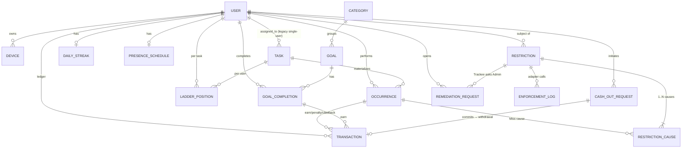

# Data model

All persistent state is Postgres 16 via TypeORM. One schema, no partitions. Migrations are timestamped files under [apps/api/src/database/migrations/](../../apps/api/src/database/migrations/); the source of truth for column types is the entity decorators in `*.entity.ts`.

See also: [../../GLOSSARY.md](../../GLOSSARY.md) for what these entities *mean*; [../adr/](../adr/) for the decisions that shaped them; [../engines/](../engines/) for how they're mutated at runtime.

## ER diagram

## Entity catalog

Source of truth for column names and types: the `*.entity.ts` files. Linked below.

### Identity & roles

- **[UserEntity](../../apps/api/src/users/user.entity.ts)** (`users`) — Every account, including the household-tablet's "synthetic user" rows. `is_admin` and `is_restrictable` are independent flags ([GLOSSARY.md §Roles](../../GLOSSARY.md#roles--accounts)). `deactivated_at` soft-deletes. `username` + `password_hash` are nullable (only Admins log in with a password). `router_id` is a legacy passthrough for the EdgeRouter; current enforcement keys off [DeviceEntity](../../apps/api/src/users/device.entity.ts).
- **[DeviceEntity](../../apps/api/src/users/device.entity.ts)** (`devices`) — Network endpoint per Restrictable Trackee. `ip_address` drives the router (internet scope); `mac_address` drives PiHole (entertainment + games). At least one must be set; the enforcement adapter logs `result='skipped'` when the relevant address kind is missing.

### Tasks, occurrences, ladders

- **[TaskEntity](../../apps/api/src/tasks/task.entity.ts)** (`tasks`) — `kind` ∈ `{reminder, recurring, windowed}`. `recurrence` is a JSONB pattern (see [../engines/recurrence.md](../engines/recurrence.md)). `ladder` is a JSONB ordered list of tier specs. `requires_verification` routes completions through pending-review. `allow_late_completion` + `late_window_minutes` gate the Miss-undo path. Windowed tasks use `window_start_offset_minutes` / `window_end_offset_minutes` relative to the day's anchor.
- **[OccurrenceEntity](../../apps/api/src/tasks/occurrence.entity.ts)** (`occurrences`) — One row per materialized instance. `status` ∈ `{active, complete, missed, pending_review, excused, deferred}`. For windowed: `scheduled_at` carries `window_start`; `window_end` is the Miss-trigger and the streak-day anchor. `local_day` is the household-local civil day of `scheduled_at` (app-maintained at insert in the household zone); the per-`(task, user, day)` uniqueness index keys on it so one household day yields one occurrence regardless of UTC offset (ADR-0007). `pending_since` stamps when `status` flipped to `pending_review`; consumed by the timeout sweep. `deferred_from_occurrence_id` links forward-deferred occurrences.
- **[LadderPositionEntity](../../apps/api/src/tasks/ladder-position.entity.ts)** (`ladder_positions`) — Per `(task, user)`. `position` is the 1-indexed tier; advances on each Miss, caps at `task.ladder.length` (last tier is "and beyond"). `clean_streak_count` resets on a Miss-with-advance, increments on a Clean occurrence, triggers a reset to position=1 when it reaches `task.ladder_reset_threshold` (default 3).
- **[DailyStreakEntity](../../apps/api/src/tasks/daily-streak.entity.ts)** (`daily_streaks`) — Per Trackee. `count` is the household-wide qualifying-day streak; `last_qualifying_day` is the ISO date of the most-recently-counted qualifying day, used by the rollover engine to detect breaks vs. non-events. See [../engines/streaks.md](../engines/streaks.md).

### Ledger

- **[TransactionEntity](../../apps/api/src/transactions/transaction.entity.ts)** (`transactions`) — Append-only. `kind` ∈ `{earn, penalty, claw_back, adjustment, withdrawal}`. `amount` is signed. `occurrence_id` and `goal_completion_id` link back to the source where applicable. `txn_group_id` pairs reversal sets (e.g. earn + claw_back; claw_back + retroactive penalty). `admin_user_id` is set when an Admin issued the row (adjustments, admin-driven rejections). Balance = `SUM(amount)`. See [../engines/ledger.md](../engines/ledger.md).
- **[CashOutRequestEntity](../../apps/api/src/transactions/cash-out-request.entity.ts)** (`cash_out_requests`) — Trackee-initiated cash-out from the wall tablet. `status` ∈ `{pending, committed, rejected}`. `committed_transaction_id` links to the `withdrawal` row once an Admin commits. Admin browser cash-outs bypass this table and append the withdrawal directly.

### Goals

- **[CategoryEntity](../../apps/api/src/goals/category.entity.ts)** (`categories`) — Sort-ordered grouping for the goals catalog.
- **[GoalEntity](../../apps/api/src/goals/goal.entity.ts)** (`goals`) — `kind` ∈ `{flat, tiered}`. `tier_values` is a JSONB int array for tiered goals. `completion_limit` + `limit_window` cap per-window completions ([../engines/](../engines/) — see [goal-limit-engine.ts](../../apps/api/src/goals/goal-limit-engine.ts)). `usable_as_remediation` makes the goal eligible to lift a Restriction. `celebration_variant_id` names a celebration variant emitted on `goals:completed`.
- **[GoalCompletionEntity](../../apps/api/src/goals/goal-completion.entity.ts)** (`goal_completions`) — One row per claim. `tier_value` is the chosen tier amount (== `goal.points` for flat goals). `goal_completion_id` on the transaction row points back here.

### Presence

- **[PresenceScheduleEntity](../../apps/api/src/presence/presence.entity.ts)** (`presence_schedules`) — One per Trackee (`user_id` unique). `recurring_rule_kind` ∈ `{none, full_time, n_week_grid}`. For grids: `grid_n_weeks` (typically 2), `grid_cells` JSONB (2-D mask), `epoch_date` ISO Monday anchor. `one_off_windows` JSONB array — vacation overrides; any matching window forces "away". Per ADR-0005 the schedule is mutable and unversioned; per ADR-0003 edits trigger reconciliation.

### Restrictions

- **[RestrictionEntity](../../apps/api/src/restrictions/restriction.entity.ts)** (`restrictions`) — One row per `(user, scope)` while active. `scope` ∈ `{internet, entertainment, games}`. `effective_expires_at` and `effective_remediation_goals` are derived from the cause list via the merge engine. `lifted_at` flips to a timestamp when the cause list empties; the row stays for audit.
- **[RestrictionCauseEntity](../../apps/api/src/restrictions/restriction-cause.entity.ts)** (`restriction_causes`) — Many per Restriction. `kind` ∈ `{miss, admin}`. `contributed_expires_at`, `contributed_remediation_goals`, `parent_only_on_expiry`, `parent_only_on_remediation` are the merge inputs (ADR-0004). MissCauses link to `occurrence_id`; AdminCauses to `admin_user_id`.
- **[EnforcementLogEntity](../../apps/api/src/restrictions/enforcement-log.entity.ts)** (`enforcement_log`) — Audit trail for every adapter call. `backend` ∈ `{router, pihole}`, `action` ∈ `{add, del}`, `result` ∈ `{ok, error, skipped}`, plus `http_status` / `error` / `target_address`. Both backends write here; the admin dashboard reads it via `RestrictionEnforcementService.recentLog`.
- **[RemediationRequestEntity](../../apps/api/src/restrictions/remediation-request.entity.ts)** (`remediation_requests`) — Trackee-initiated "please consider this remediation" message to the Admin. `status` ∈ `{open, resolved}`.

### Settings

- **[HouseholdSettingsEntity](../../apps/api/src/household-settings/household-settings.entity.ts)** (`household_settings`) — Single-row table. Holds the household `time_zone` (the single civil-time zone for the whole app — see ADR-0007; admin-editable, exposed read-only to the tablet via `GET /settings/public`), audible-warning HH:MM, pending-review timeout, daily-streak bonus amount, and similar global knobs.

## Migration conventions

- One TypeORM migration per feature, filename pattern `<unix-millis>-<slug>.ts`. The leading timestamp orders them; the slug is documentary.
- TypeORM CLI commands run via `npm --workspace apps/api run migration:run` / `migration:generate`. In production the Compose `migrate` one-shot service applies pending migrations before the API starts (see [../development.md](../development.md)).
- Migrations are forward-only; downgrades are not supported.
- Data-source config: [apps/api/src/database/data-source.ts](../../apps/api/src/database/data-source.ts).

## Files to read

- All `*.entity.ts` files listed above
- [apps/api/src/database/data-source.ts](../../apps/api/src/database/data-source.ts)
- [apps/api/src/database/migrations/](../../apps/api/src/database/migrations/)
