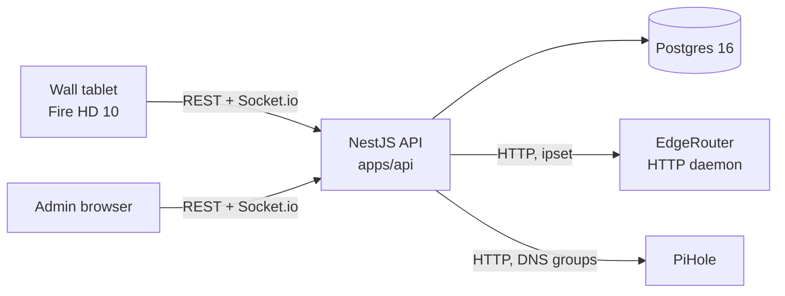
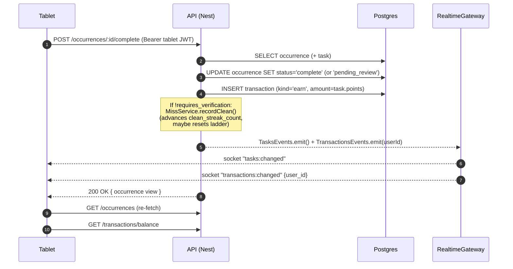

# Architecture overview

Single NestJS monolith + Postgres + a Vite-built React SPA, deployed as three containers (API, web, Postgres). All scheduling is in-process via `setInterval`; there is no external queue, cache, or message bus. Realtime push to the tablet is a Socket.io WebSocket; HTTP traffic is REST.

See also: [../../GLOSSARY.md](../../GLOSSARY.md), [../adr/](../adr/), [data-model.md](data-model.md), [scheduling.md](scheduling.md), [realtime.md](realtime.md).

## System context

The two surfaces are served from the same Vite bundle:

- **Wall tablet** — [apps/web/src/pages/TabletPage.tsx](../../apps/web/src/pages/TabletPage.tsx). Long-lived JWT, household-tablet session, no admin capability.
- **Admin browser** — [apps/web/src/admin/AdminShell.tsx](../../apps/web/src/admin/AdminShell.tsx) shelling 17 `Admin*Page.tsx` pages under [apps/web/src/pages/](../../apps/web/src/pages/). 12h-TTL JWT, admin capability.

Auth detail: [../auth-and-sessions.md](../auth-and-sessions.md).

## Backend module map

The API is a NestJS monolith. Each domain concept maps to a feature module under [apps/api/src/](../../apps/api/src/). Convention per module: `*.module.ts` (wiring), `*.controller.ts` (HTTP), `*.service.ts` (logic), `*.entity.ts` (TypeORM), `dto.ts` (request/response shapes), `*.spec.ts` (unit tests). Services publish realtime events on the shared `RealtimeBus` ([realtime/](../../apps/api/src/realtime/)), which the Socket.IO gateway fans out to clients.

| Module | Domain | Engine doc |
| --- | --- | --- |
| [auth/](../../apps/api/src/auth/) | JWT issuance, tablet enrollment | [../auth-and-sessions.md](../auth-and-sessions.md) |
| [users/](../../apps/api/src/users/) | Trackee, Device, roster | — |
| [tasks/](../../apps/api/src/tasks/) | Task, Occurrence, Miss, Ladder, streaks | [../engines/recurrence.md](../engines/recurrence.md), [../engines/miss-detection.md](../engines/miss-detection.md), [../engines/streaks.md](../engines/streaks.md) |
| [pending-review/](../../apps/api/src/pending-review/) | Optimistic-earn / approve / reject | [../engines/pending-review.md](../engines/pending-review.md) |
| [transactions/](../../apps/api/src/transactions/) | Append-only ledger, cash-out | [../engines/ledger.md](../engines/ledger.md) |
| [goals/](../../apps/api/src/goals/) | Goal, Tiered goal, Goal completion, limits | — |
| [presence/](../../apps/api/src/presence/) | Presence schedule, resolver, reconciliation | [../engines/presence.md](../engines/presence.md) |
| [restrictions/](../../apps/api/src/restrictions/) | Cause merge, scope dispatch, enforcement adapters | [../engines/restrictions.md](../engines/restrictions.md) |
| [household-settings/](../../apps/api/src/household-settings/) | Pending-review timeout, audible-warning time, bonus amount | — |
| [audible-warning/](../../apps/api/src/audible-warning/) | Household-wide nudge | — |
| [realtime/](../../apps/api/src/realtime/) | WebSocket gateway, event fan-out | [realtime.md](realtime.md) |
| [clock/](../../apps/api/src/clock/) | `Clock` port (`SystemClock` / `FakeClock`) | [scheduling.md](scheduling.md) |
| [database/](../../apps/api/src/database/) | TypeORM data source, migrations | [data-model.md](data-model.md) |
| [e2e/](../../apps/api/src/e2e/) | Test-only `/_e2e/*` endpoints + fake HTTP clients | [../testing.md](../testing.md) |

## Request lifecycle: Trackee taps "Complete" on the tablet

The HTTP response and the socket fan-out race; the tablet treats both as triggers to re-fetch the affected resources. The socket payloads are deliberately thin (`{ at, user_id? }`) — no diffs, no entity snapshots.

Code paths: [occurrences.controller.ts:61](../../apps/api/src/tasks/occurrences.controller.ts#L61), [occurrences.service.ts:326](../../apps/api/src/tasks/occurrences.service.ts#L326), [realtime.gateway.ts:52](../../apps/api/src/realtime/realtime.gateway.ts#L52).

## Process model

- One Node process per API container; NestJS monolith — no microservices.
- Four in-process `setInterval` timers on `onModuleInit` (deadline tick, day rollover, restriction wait-out sweep, pending-review timeout sweep). All gated off when `E2E_TEST_MODE=true`. See [scheduling.md](scheduling.md).
- Side-effecting services wrap pure engines (`tasks/miss/`, `tasks/recurrence/`, `restrictions/restriction-merge.ts`, `presence/presence-resolver.ts`, `presence/presence-reconcile.ts`). The pure engines have no DB / DI and are exhaustively unit-tested; the services own persistence and event emission.
- Realtime events are an RxJS `Subject` per feature module, subscribed by [realtime.gateway.ts](../../apps/api/src/realtime/realtime.gateway.ts) and broadcast to all connected clients (no per-user rooms — clients filter on `user_id`).

## Files to read

- [apps/api/src/app.module.ts](../../apps/api/src/app.module.ts) — feature-module imports
- [apps/api/src/main.ts](../../apps/api/src/main.ts) — bootstrap, CORS, port
- [apps/api/src/database/data-source.ts](../../apps/api/src/database/data-source.ts) — TypeORM config
- [apps/web/src/main.tsx](../../apps/web/src/main.tsx) and [apps/web/src/auth/AuthProvider.tsx](../../apps/web/src/auth/AuthProvider.tsx)
