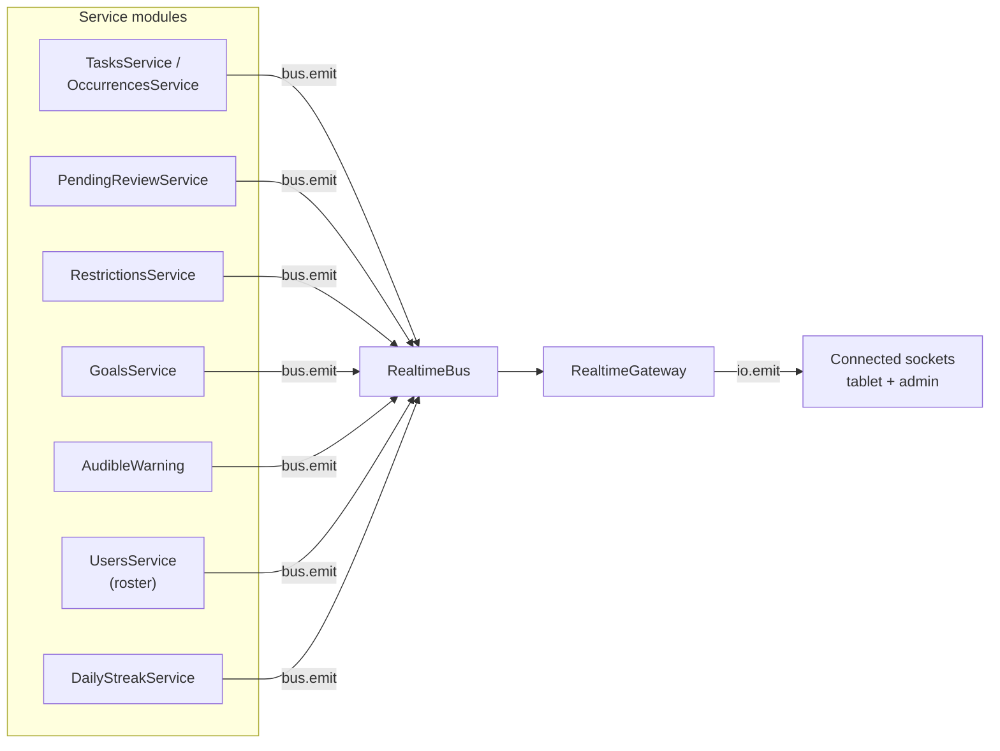
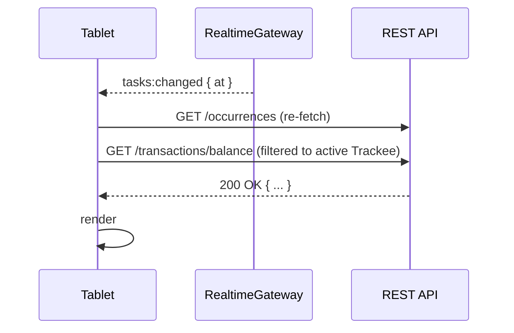

# Realtime gateway

Tablets and admin browsers stay in sync via a single Socket.io WebSocket. Events are deliberately thin — the gateway pushes `{ at, user_id? }` and the client refetches the affected REST resource. No diff streams, no entity payloads, no per-user rooms.

See also: [overview.md](overview.md), [../auth-and-sessions.md](../auth-and-sessions.md), [scheduling.md](scheduling.md).

## How it's wired

Services publish typed events with `bus.emit({ kind, ... })` on the in-process [RealtimeBus](../../apps/api/src/realtime/realtime-bus.ts), a single RxJS `Subject` over the `RealtimeEvent` union. The bus lives in its own leaf module (`RealtimeBusModule`), so feature modules can import it without pulling in the gateway. The gateway subscribes once in `afterInit()` and maps each event to its wire payload with `server.emit(<event>, payload)`. Code: [apps/api/src/realtime/realtime.gateway.ts](../../apps/api/src/realtime/realtime.gateway.ts).

## Event catalog

All payloads include `at: ISO timestamp`. Names and shapes match the gateway exactly.

| Event | Payload | Emitter | Fires when |
| --- | --- | --- | --- |
| `users:roster_changed` | `{ at }` | `RealtimeBus` | A Trackee is added / updated / deactivated |
| `tasks:changed` | `{ at }` | `RealtimeBus` | Occurrence status mutation (complete, miss fired, late-complete, excused, deferred, approve, reject) |
| `transactions:changed` | `{ at, user_id }` | `RealtimeBus` | A row appended to `transactions` for that user |
| `goals:changed` | `{ at }` | `RealtimeBus` | Catalog mutation (goal/category CRUD) |
| `goals:completed` | `{ at, user_id, goal_id, goal_name, amount, celebration_variant_id }` | `RealtimeBus` | A claim posts an earn — drives the tablet celebration overlay |
| `restrictions:changed` | `{ at, user_id }` | `RealtimeBus` | A Cause appended / removed; Restriction lifted; merge recompute |
| `audible_warning:fire` | `{ at }` | `RealtimeBus` | The household-wide nudge time arrived and conditions are met |

There is no `auth_error` retry payload; on bad/missing tokens the gateway disconnects after emitting one `auth_error` message ([realtime.gateway.ts:97-112](../../apps/api/src/realtime/realtime.gateway.ts#L97)).

## Auth on the handshake

Socket.io clients pass the JWT via `auth.token` (preferred) or an `Authorization: Bearer …` header. The gateway validates with `AuthService.verifyToken`; failure disconnects the socket. The verified payload is stashed on `client.data.session` for the `ping` handler. Code: [realtime.gateway.ts:97-125](../../apps/api/src/realtime/realtime.gateway.ts#L97).

The web client passes the active session token through the `auth` field on connect: [apps/web/src/hooks/useSocket.ts:18-24](../../apps/web/src/hooks/useSocket.ts#L18).

## Client-side consumption

The tablet treats every event as a "refetch trigger." Handlers persist across reconnects: `useSocket` keeps a `subscriptions` map and re-binds on every new `socket` instance ([useSocket.ts:31-35](../../apps/web/src/hooks/useSocket.ts#L31)). Reconnect cadence is `reconnectionDelay: 500ms`, `reconnectionDelayMax: 5000ms`.

Typical flow:

No event carries enough data to update local state in isolation — re-fetching is the contract. This keeps the gateway simple (one RxJS subject per concern) and makes auth-scoped filtering trivial (each REST call already authorizes on its own).

## Why all-broadcast (not per-user rooms)

The household has ≤6 connected clients. Filtering server-side would add per-room bookkeeping and per-emit gymnastics for zero meaningful saving. Clients filter on `user_id` in the payload when needed; the rest are global.

## Files to read

- [apps/api/src/realtime/realtime.gateway.ts](../../apps/api/src/realtime/realtime.gateway.ts)
- [apps/api/src/realtime/realtime.module.ts](../../apps/api/src/realtime/realtime.module.ts)
- [apps/web/src/hooks/useSocket.ts](../../apps/web/src/hooks/useSocket.ts)
- [apps/api/src/realtime/realtime-bus.ts](../../apps/api/src/realtime/realtime-bus.ts)
