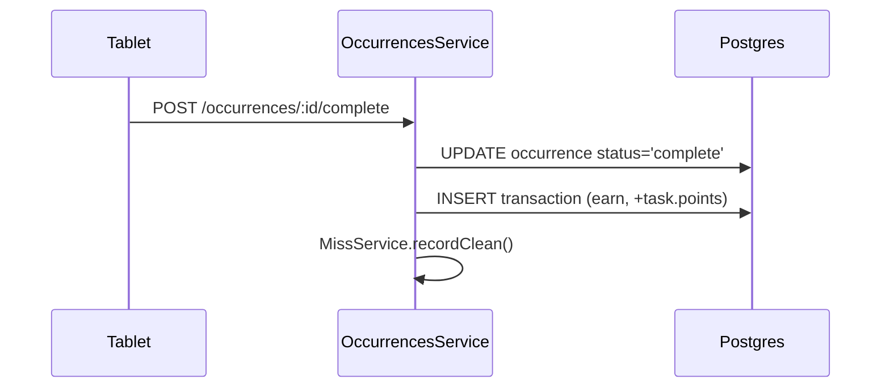
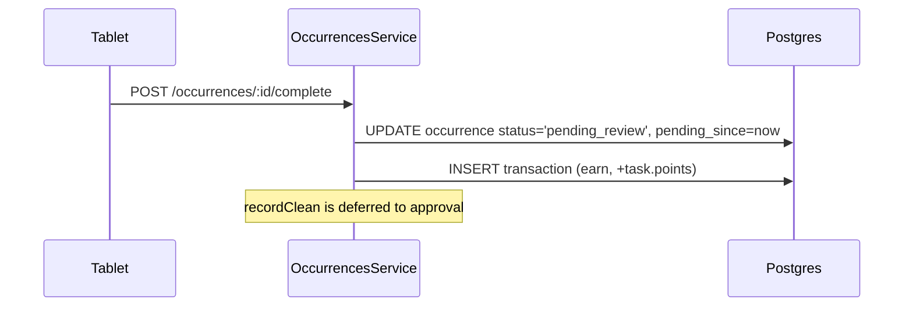
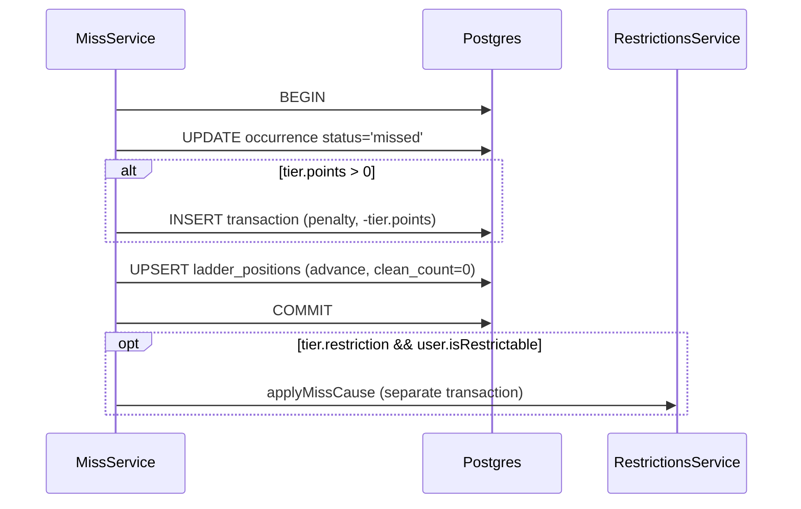
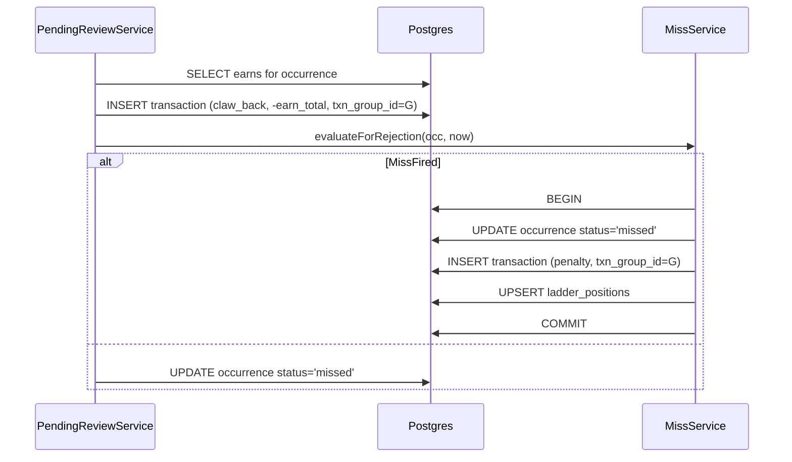

# Ledger

Every change to a Trackee's points balance is one signed row in `transactions`. Append-only — there is no update path and no running-balance entity. Balance is `SUM(amount)` at query time.

See also: [../../GLOSSARY.md](../../GLOSSARY.md) (Transaction, Adjust Balance, Cash-out), [pending-review.md](pending-review.md), [miss-detection.md](miss-detection.md), [streaks.md](streaks.md), [presence.md](presence.md).

## Transaction kinds

`TransactionEntity.kind` ([transaction.entity.ts](../../apps/api/src/transactions/transaction.entity.ts)):

| Kind | Sign | Source | Notes |
| --- | --- | --- | --- |
| `earn` | + | Task completion, Goal claim, Daily-streak bonus | Optimistic on `pending_review` |
| `penalty` | − | Miss fired | Amount = current tier's points |
| `claw_back` | + or − | Reversal of a prior row | Always paired with the row it reverses via `txn_group_id` |
| `adjustment` | ± | Admin "Adjust Balance" | Carries `admin_user_id` and an optional `reason` |
| `withdrawal` | − | Cash-out commit | Linked to `cash_out_requests` if tablet-initiated |

`penalty` and `adjustment` are intentionally distinct kinds even when both are negative — the distinction is "system-issued vs. Admin-discretionary." UI filters and audit queries depend on it.

## Append-only invariant

```ts
TransactionsService.append({ userId, kind, amount, reason, adminUserId, occurrenceId, goalCompletionId })
```

[transactions.service.ts](../../apps/api/src/transactions/transactions.service.ts) is intentionally narrow — one method to write, two to read. There is no `update`, no `delete`. Reversals are new rows, not mutations. Balance derivation is a pure `SUM`:

```ts
balanceFor(userId) → SELECT COALESCE(SUM(amount), 0) FROM transactions WHERE user_id = $1
```

Some emitters bypass `TransactionsService.append` and use the TypeORM repository directly when they need to set `txn_group_id` (which `append` doesn't expose). Examples: [miss.service.ts:209](../../apps/api/src/tasks/miss.service.ts#L209), [pending-review.service.ts:139](../../apps/api/src/pending-review/pending-review.service.ts#L139), [occurrence-actions.service.ts:285](../../apps/api/src/tasks/occurrence-actions.service.ts#L285), [presence-reconciliation.service.ts:159](../../apps/api/src/presence/presence-reconciliation.service.ts#L159). Always treat these as append calls — same invariant.

## `txn_group_id`: pairing reversals

When an action posts a reversal, the original row's `id` (or a fresh UUID) is set as `txn_group_id` on **both** rows so the pair can be queried as a unit. The wrapping service generates the group id and threads it through both inserts inside the same DB transaction.

Examples in code:
- **Late completion** ([occurrence-actions.service.ts:219](../../apps/api/src/tasks/occurrence-actions.service.ts#L219)): one `claw_back` reversing the `penalty`. Both share a `randomUUID()` group.
- **Pending-review rejection** ([pending-review.service.ts:129](../../apps/api/src/pending-review/pending-review.service.ts#L129)): three rows — original `earn`, new `claw_back`, new `penalty`. The claw_back and penalty share a fresh group id; the original earn is tagged with the same id by the rejection path.
- **Presence reconciliation reverse** ([presence-reconciliation.service.ts:152](../../apps/api/src/presence/presence-reconciliation.service.ts#L152)): `claw_back` carries the original penalty's `txn_group_id` if it has one, else null.

There is no DB constraint enforcing pairing — it's a convention. A query like `WHERE txn_group_id = ?` is the audit primitive.

## Atomic sequences

### Completion (no review)



Not wrapped in a single `BEGIN/COMMIT` — two separate writes. The status update and earn are intended to commit independently; the worst-case observable state is "complete but earn not yet visible," which the tablet re-fetches past on the next `transactions:changed` event.

### Completion (requires_verification → pending_review)



The `earn` is **optimistic**. If the Admin rejects, the rejection path issues a `claw_back` and fires the Miss (see [pending-review.md](pending-review.md)).

### Miss firing



The four-effect tuple commits inside one DB transaction ([miss.service.ts:203-239](../../apps/api/src/tasks/miss.service.ts#L203)). The optional restriction-cause emit happens after commit; failures there are logged but do not roll back the Miss.

### Pending-review rejection



The claw_back is posted outside the Miss-transaction (its own write) but **shares the same `txn_group_id`** with the penalty. A future audit query can recover the full group from any one row.

## Cash-out

Two paths:

1. **Admin cash-out** (admin browser) — `CashOutService.adminCashOut()` appends `{kind:'withdrawal', amount:-x}` directly. No row in `cash_out_requests`.
2. **Tablet cash-out request** — `CashOutService.requestCashOut()` inserts `cash_out_requests {status:'pending'}` with **no ledger write**. Admin commit calls `commitRequest()` which appends the `withdrawal` and flips status to `committed`, recording `committed_transaction_id`. Reject flips to `rejected`, no ledger row.

Cash-out is blocked while the balance is negative ([cash-out.service.ts](../../apps/api/src/transactions/cash-out.service.ts)).

Reversing a committed cash-out: post a positive `adjustment` with reason "withdrawal reversed". There is no dedicated reversal action — the convention is documented in [../../GLOSSARY.md](../../GLOSSARY.md#cash-out-request).

## Audit query patterns

Recover every txn touching one occurrence:

```sql
SELECT * FROM transactions WHERE occurrence_id = $1 ORDER BY created_at;
```

Recover an earn + claw_back pair (or claw_back + penalty pair):

```sql
SELECT * FROM transactions WHERE txn_group_id = $1 ORDER BY created_at;
```

Recompute a Trackee's balance:

```sql
SELECT COALESCE(SUM(amount), 0) FROM transactions WHERE user_id = $1;
```

`historyFor()` ([transactions.service.ts:69-99](../../apps/api/src/transactions/transactions.service.ts#L69)) is the API-side abstraction; it supports `bucket: 'earned' | 'spent' | 'all'` filtering for the tablet's history view.

## What never enters the ledger

- Restriction state changes — they live in `restrictions` / `restriction_causes`, not the ledger.
- Daily-streak counter increments (only the bonus `earn` row).
- Clean-streak counter mutations.
- Excused / Deferred occurrence transitions.

## Files to read

- [apps/api/src/transactions/transaction.entity.ts](../../apps/api/src/transactions/transaction.entity.ts)
- [apps/api/src/transactions/transactions.service.ts](../../apps/api/src/transactions/transactions.service.ts)
- [apps/api/src/transactions/cash-out.service.ts](../../apps/api/src/transactions/cash-out.service.ts)
- [apps/api/src/transactions/cash-out-request.entity.ts](../../apps/api/src/transactions/cash-out-request.entity.ts)
- [apps/api/src/tasks/miss.service.ts](../../apps/api/src/tasks/miss.service.ts)
- [apps/api/src/pending-review/pending-review.service.ts](../../apps/api/src/pending-review/pending-review.service.ts)
- [apps/api/src/tasks/occurrence-actions.service.ts](../../apps/api/src/tasks/occurrence-actions.service.ts)
