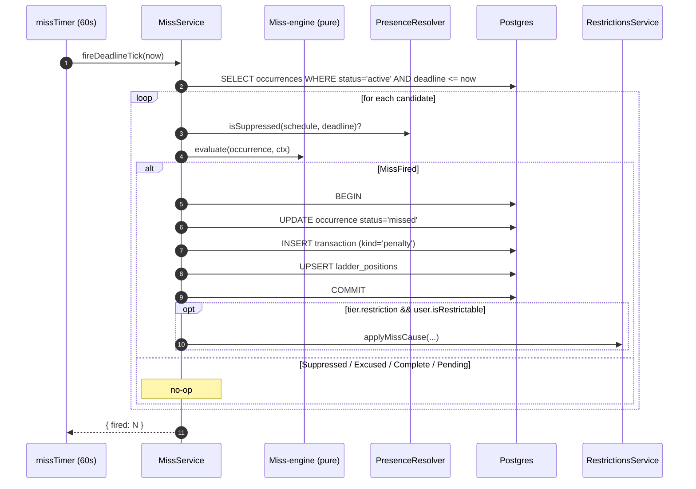
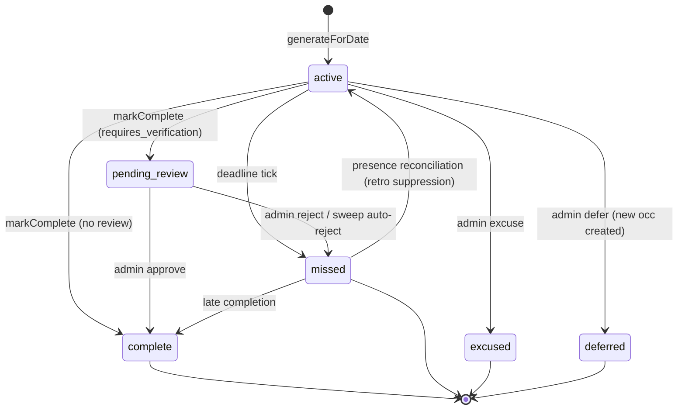

# Miss detection

A **Miss** is the event that fires when a task occurrence reaches its deadline without being completed or excused. The Miss-engine evaluates one occurrence at a time and returns a state outcome; the wrapping service applies the four-effect tuple atomically.

See also: [../../GLOSSARY.md](../../GLOSSARY.md) (Miss, Tier, Escalation ladder), [../adr/0001-late-completion-is-a-full-undo.md](../adr/0001-late-completion-is-a-full-undo.md), [../adr/0002-pending-review-defers-miss-until-rejection.md](../adr/0002-pending-review-defers-miss-until-rejection.md), [../adr/0003-presence-is-derived-with-retroactive-reconciliation.md](../adr/0003-presence-is-derived-with-retroactive-reconciliation.md), [ledger.md](ledger.md), [pending-review.md](pending-review.md), [presence.md](presence.md), [streaks.md](streaks.md), [restrictions.md](restrictions.md).

## What "firing a Miss" means

Four effects, applied atomically inside a single DB transaction:

1. **Status flip** — `occurrence.status` → `missed`, `pending_since` cleared.
2. **Penalty transaction** — append `{kind:'penalty', amount: -tier.points}` (skipped if `tier.points === 0`).
3. **Ladder advance** — upsert `ladder_positions` with `position = next_tier`, `clean_streak_count = 0`.
4. **Restriction Cause** — if the tier carries a `restriction` spec AND the Trackee is Restrictable, append a MissCause to the merged Restriction for the spec's scope.

A fifth effect — the **streak break** — is observed indirectly: the day-rollover classifier reads any `missed` occurrence as "break this day." See [streaks.md](streaks.md).

Code: [miss.service.ts:195-274](../../apps/api/src/tasks/miss.service.ts#L195) (`applyMissOutcome`).

## When does a Miss fire?



**Deadline rule** (per task kind):
- `recurring` → `scheduled_at` (= day + `due_time`)
- `windowed` → `window_end`
- `reminder` tasks never enter the Miss query — their deadline is informational only.

The query reads `status='active'` with `deadline <= now`; flipping to `missed` excludes the row from the next sweep, so it's naturally idempotent.

Presence schedules are cached per-sweep (one query per Trackee per tick) to avoid `N×M` lookups.

Code: [miss.service.ts:58-130](../../apps/api/src/tasks/miss.service.ts#L58).

## The pure Miss-engine

`evaluate(occurrence, context) → MissEvaluation` ([miss-engine.ts:62](../../apps/api/src/tasks/resolution/miss-engine.ts#L62)).

Decision table:

| Condition | Outcome |
| --- | --- |
| `presenceSuppressed === true` | `Suppressed` — no-op, no Miss |
| `status ∈ {excused, deferred}` | `Excused` — no-op |
| `status ∈ {complete, pending_review, missed}` | `Complete` — no-op |
| `deadline > now` | `Pending` — too early |
| otherwise (active and past deadline) | `MissFired` — return effects tuple |

`pending_review` is treated as Complete here — points were credited optimistically; the rejection path re-evaluates at rejection time (see [pending-review.md](pending-review.md)).

The engine has zero side effects: pass `{ ladder, position, now, isRestrictable }`, get back a discriminated union. Side-effecting wiring lives in [miss.service.ts](../../apps/api/src/tasks/miss.service.ts).

## Occurrence status state machine



## Escalation ladder

`task.ladder` is a JSONB ordered array of Tier specs:

```ts
{ points: number, restriction?: { type, duration_minutes, remediation_goal_ids } | null }
```

`step(ladder, position, 'miss')` ([escalation-ladder.ts](../../apps/api/src/tasks/resolution/escalation-ladder.ts)) returns the next position (`min(position+1, ladder.length)`) plus the payload at that position. The last tier is "and beyond": once reached, further Misses repeat its payload without advancing further.

A **Clean streak** of `ladder_reset_threshold` consecutive Clean occurrences resets the position to 1 (see [streaks.md](streaks.md) §Clean streak).

## Reversal paths

A Miss can be undone three ways. Each reverses the same four effects atomically.

### 1. Late completion (ADR-0001)

Within `scheduled_at + late_window_minutes` (default 720 = 12 hours) and only for `recurring` tasks with `allow_late_completion=true`. Code: [occurrence-actions.service.ts:194-269](../../apps/api/src/tasks/occurrence-actions.service.ts#L194).

What happens:
- `occurrence.status` → `complete`
- Append `claw_back` for the penalty amount (sharing a fresh `txn_group_id` with the original)
- Retract ladder by one tier (floor 1); `clean_streak_count` → 0
- Remove all MissCauses tied to this occurrence; the merge engine recomputes or lifts the Restriction
- If the broken day already rolled over: bump `daily_streaks.count` and `last_qualifying_day` to restore the streak

### 2. Pending-review rejection re-fire (inverse — not an undo)

The Miss didn't fire when the occurrence flipped to `pending_review`; it fires *at rejection time*. The earn that was posted optimistically is clawed back. See [pending-review.md](pending-review.md).

### 3. Presence reconciliation (ADR-0003)

When a Trackee's Presence schedule is edited and a previously-fired Miss is now in a suppressed window, the reconciliation service reverses the Miss: claw back the penalty, retract the ladder, flip the occurrence back to `active` so it reads as suppressed-derived on next read. See [presence.md](presence.md).

The inverse — a Miss firing retroactively because an occurrence is **newly no-longer-suppressed** — is also handled.

## Files to read

- [apps/api/src/tasks/resolution/miss-engine.ts](../../apps/api/src/tasks/resolution/miss-engine.ts)
- [apps/api/src/tasks/resolution/escalation-ladder.ts](../../apps/api/src/tasks/resolution/escalation-ladder.ts)
- [apps/api/src/tasks/miss.service.ts](../../apps/api/src/tasks/miss.service.ts)
- [apps/api/src/tasks/occurrence-actions.service.ts](../../apps/api/src/tasks/occurrence-actions.service.ts)
- [apps/api/src/tasks/resolution/miss-engine.spec.ts](../../apps/api/src/tasks/resolution/miss-engine.spec.ts), [escalation-ladder.spec.ts](../../apps/api/src/tasks/resolution/escalation-ladder.spec.ts)
