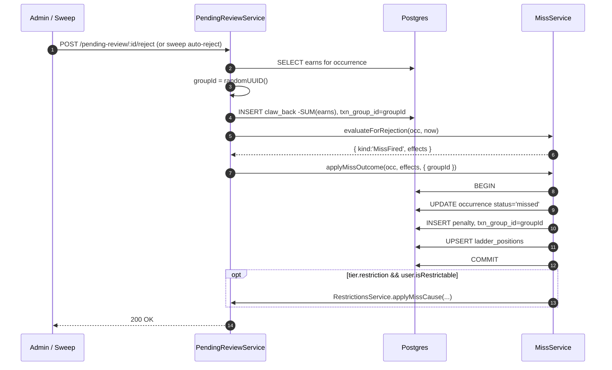
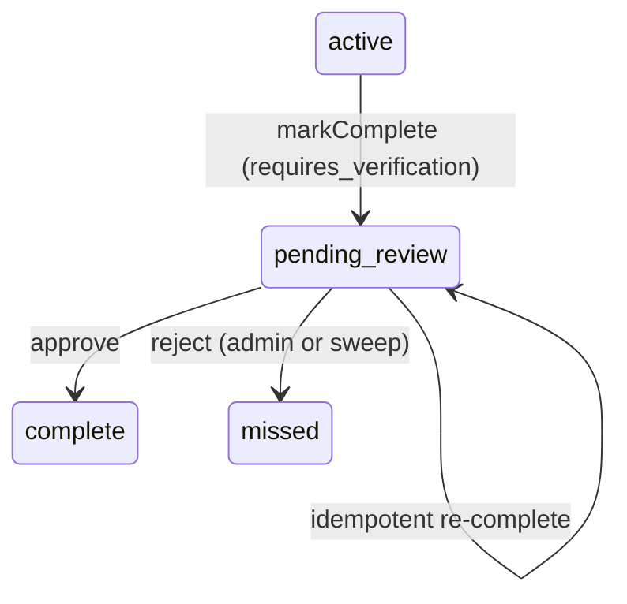

# Pending review

A "Pending review" occurrence is one where the Trackee marked the task done but an Admin must verify. The earn is posted optimistically; on rejection it's clawed back and the Miss is fired at rejection time.

See also: [../adr/0002-pending-review-defers-miss-until-rejection.md](../adr/0002-pending-review-defers-miss-until-rejection.md), [../../GLOSSARY.md](../../GLOSSARY.md#pending-review), [miss-detection.md](miss-detection.md), [ledger.md](ledger.md).

## Entry condition

`task.requires_verification === true` AND `occurrence.status === 'active'` AND the Trackee taps Complete. The completion handler ([occurrences.service.ts:326-366](../../apps/api/src/tasks/occurrences.service.ts#L326)) sets `status = 'pending_review'`, stamps `pending_since = clock.now()`, and posts the earn transaction immediately:

```ts
if (requiresVerification) {
  occ.status = 'pending_review';
  occ.pendingSince = this.clock.now();
} else {
  occ.status = 'complete';
}
// earn is posted unconditionally
transactions.append({ kind:'earn', amount: task.points, occurrenceId: occ.id });
// recordClean is skipped for pending; deferred to approval
```

The Clean-streak counter is **not** advanced until approval — provisional success doesn't count.

## Approve

```mermaid
sequenceDiagram
  autonumber
  participant A as Admin
  participant API as PendingReviewService
  participant DB as Postgres
  participant MS as MissService

  A->>API: POST /pending-review/:id/approve
  API->>DB: SELECT occurrence WHERE status='pending_review'
  API->>DB: UPDATE occurrence status='complete', pending_since=NULL
  API->>MS: recordClean(occ.id)
  Note over MS: advance clean_streak_count;<br/>maybe reset ladder to position=1
  API-->>A: 200 OK
```

No ledger writes on approve — the optimistic earn is already in place. The only state change is the status flip plus the clean-streak advance.

Code: [pending-review.service.ts:80-94](../../apps/api/src/pending-review/pending-review.service.ts#L80).

## Reject

Reject is structurally the inverse of "approve, plus fire the Miss at this moment". Three atomic effects, all sharing a fresh `txn_group_id`:



Key invariants:

1. **Claw-back amount is the SUM of prior earns on this occurrence** — not a re-read of `task.points`. A future task-edit can't change what gets refunded ([pending-review.service.ts:134-138](../../apps/api/src/pending-review/pending-review.service.ts#L134)).
2. **The Miss fires at rejection time**, not at the original deadline. The penalty amount reflects the *current* ladder position; the ladder advance bumps from that position.
3. **`txn_group_id` ties the trio** — the earn (posted by completion) gets the same group id stamped via the rejection path; the claw_back and penalty are both inserted with that id, so a single `WHERE txn_group_id = $1` query recovers the audit chain.
4. **MissEvaluation may return non-fire** (e.g., the occurrence was somehow already past due-time but for a Trackee who's now Presence-suppressed). In that case the status still flips to `missed` but no effects post ([pending-review.service.ts:163-168](../../apps/api/src/pending-review/pending-review.service.ts#L163)).

Code: [pending-review.service.ts:119-180](../../apps/api/src/pending-review/pending-review.service.ts#L119).

## Auto-reject sweep

The Pending-review sweep timer (60s) auto-rejects entries older than `pendingReviewTimeoutMs` (a `household_settings` knob). The reject path is identical except `adminUserId = null` — telling the log emitter it was sweep-driven.

Code: [pending-review.service.ts:183-207](../../apps/api/src/pending-review/pending-review.service.ts#L183), [pending-review.module.ts:43-52](../../apps/api/src/pending-review/pending-review.module.ts#L43).

## State transitions



`pending_review → complete` cleans `pending_since`; the optimistic earn stays.
`pending_review → missed` triggers the three-row ledger group (earn, claw_back, penalty).

## Interaction with the deadline tick

The Miss-engine treats `pending_review` as Complete ([miss-engine.ts](../../apps/api/src/tasks/resolution/miss-engine.ts)). The deadline tick never fires a Miss on a pending occurrence even if it's past `due_time`. The only paths out of `pending_review` are approve, reject, or sweep-auto-reject — never the deadline tick. This is ADR-0002's central claim.

## Files to read

- [apps/api/src/pending-review/pending-review.service.ts](../../apps/api/src/pending-review/pending-review.service.ts)
- [apps/api/src/pending-review/pending-review.module.ts](../../apps/api/src/pending-review/pending-review.module.ts)
- [apps/api/src/pending-review/pending-review.controller.ts](../../apps/api/src/pending-review/pending-review.controller.ts)
- [apps/api/src/tasks/occurrences.service.ts](../../apps/api/src/tasks/occurrences.service.ts)
- [apps/api/src/tasks/resolution/miss-engine.ts](../../apps/api/src/tasks/resolution/miss-engine.ts)
- [apps/api/src/tasks/miss.service.ts](../../apps/api/src/tasks/miss.service.ts) (`evaluateForRejection`, `applyMissOutcome`)
