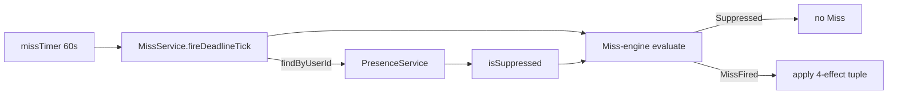
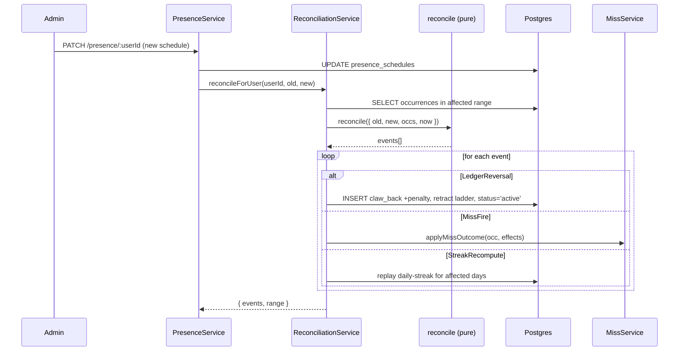

# Presence

Presence answers "is this Trackee home right now?". It's a derived predicate, not a stored flag, so retroactive edits to the schedule propagate automatically — and trigger a **reconciliation** that reverses or re-fires past Miss effects to match the new truth.

See also: [../adr/0003-presence-is-derived-with-retroactive-reconciliation.md](../adr/0003-presence-is-derived-with-retroactive-reconciliation.md), [../adr/0005-presence-schedule-is-not-versioned.md](../adr/0005-presence-schedule-is-not-versioned.md), [../../GLOSSARY.md](../../GLOSSARY.md#presence), [miss-detection.md](miss-detection.md), [ledger.md](ledger.md).

## Schedule shapes

`PresenceScheduleEntity.recurring_rule_kind` ([presence.entity.ts](../../apps/api/src/presence/presence.entity.ts)):

- `none` — no tracking; treated as always-home.
- `full_time` — always home.
- `n_week_grid` — fixed-length cells × weekday mask anchored by `epoch_date`.

Plus `one_off_windows`: array of `{ start, end, label }` JSONB. Any window matching the queried instant forces "away" regardless of the recurring rule.

### The n-week grid

Anchored by `epoch_date` (an ISO `YYYY-MM-DD`). The resolver snaps that date to the ISO Monday of the same week and uses modulo `grid_n_weeks` to pick Week A / Week B / etc. for any other date.

```
Week A:   [Mo][Tu][We][Th][Fr][Sa][Su]
Week B:   [Mo][Tu][We][Th][Fr][Sa][Su]
            ↑
            cells = { kind: 'home' | 'away', handoff_time?: 'HH:MM' }
```

Each cell has a `kind` and an optional `handoff_time` (24h). A cell with a `handoff_time` defines a **transition** at that time-of-day **in the household zone**; a cell without one inherits the running state from prior cells. The resolver reads the instant's weekday, minute-of-day, and the vacation-window date all in the household time zone — `isHome(schedule, instant, tz)` (ADR-0007), not in UTC.

Reading a state at an instant: scan back ≤ `grid_n_weeks` cycles for the most recent transition at-or-before that instant. Adjacent home cells with no time on the right are continuous; likewise away cells.

Code: [presence-resolver.ts](../../apps/api/src/presence/presence-resolver.ts).

## The resolver

```ts
isHome(schedule, instant, tz) → boolean
isSuppressed(schedule, effectiveAt, tz) → !isHome(...)
```

Decision order in `isHome` ([presence-resolver.ts:72](../../apps/api/src/presence/presence-resolver.ts#L72)):

1. If the instant falls in any `one_off_windows` → `false` (away)
2. Branch on `recurring_rule_kind`:
   - `full_time` | `none` → `true`
   - `n_week_grid` → resolve the cell at that instant

The resolver is pure, dep-free, exhaustively unit-tested ([presence-resolver.spec.ts](../../apps/api/src/presence/presence-resolver.spec.ts)).

## How suppression flows into the Miss-engine



The deadline tick caches the schedule per-sweep ([miss.service.ts:71-92](../../apps/api/src/tasks/miss.service.ts#L71)) so multiple occurrences for the same Trackee on one tick do one schedule lookup.

A presence-suppressed occurrence at deadline:
- Misses-engine returns `{ kind: 'Suppressed' }`
- No status flip; the occurrence stays `active`
- Day-rollover classifies it as `non-event` for the Daily routine streak

## Retroactive reconciliation (ADR-0003)

The schedule is mutable and unversioned — every read uses the *current* rule. This means a schedule edit can change the truth of past occurrences. The reconciliation orchestrator detects which past occurrences flipped state and applies the corresponding side effects.

### The pure engine

`reconcile({ oldSchedule, newSchedule, occurrences, now })` ([presence-reconcile.ts:59](../../apps/api/src/presence/presence-reconcile.ts#L59)) walks each occurrence in the affected range and emits events:

| Event | Trigger |
| --- | --- |
| `LedgerReversal` | Occurrence was `missed`, now suppressed → undo the Miss |
| `MissFire` | Occurrence was `active` & past deadline & previously suppressed → fire Miss now |
| `StreakRecompute` | Any user with at least one flipped occurrence — recompute daily streak counters for the affected days |

### The orchestrator

`PresenceReconciliationService.reconcileForUser(userId, oldSchedule, newSchedule, now)` ([presence-reconciliation.service.ts:58](../../apps/api/src/presence/presence-reconciliation.service.ts#L58)) is wired into every `PresenceService` write — every schedule edit calls it with `(before, after)` snapshots.



### Affected date range

`affectedDateRange(old, new)` returns a bounded ISO date range when possible:

- **Vacation-window diff only** → range is the union of added/removed windows. Tight.
- **Recurring-rule / grid / epoch change** → open-ended in principle. The orchestrator falls back to a trailing **90 days** ([presence-reconciliation.service.ts:21](../../apps/api/src/presence/presence-reconciliation.service.ts#L21)) so work stays bounded. Older Miss effects are not retroactively reversed.

### `StreakRecompute` details

For each affected day in order:
1. Re-classify the day under the *new* schedule (`classifyDay(occs)` with `presenceSuppressed = isSuppressed(newSchedule, occ.scheduledAt)`)
2. Walk `applyDay(state, classification)` to get the next streak state
3. **Pay** a retroactive bonus `earn` if a day newly classifies as `advance` and no prior bonus row exists for that day
4. **Claw back** a prior bonus row if the day now classifies as `break` or `non-event`

Bonus rows are matched by `reason = 'daily routine streak'` and `created_at`'s ISO day ([presence-reconciliation.service.ts:248-259](../../apps/api/src/presence/presence-reconciliation.service.ts#L248)). The match is by day, not by `occurrence_id` (bonus rows don't have one).

## Why not versioned?

ADR-0005's claim: a versioned schedule would mean every occurrence read also reads "which version was effective at the occurrence's time" — extra schema, extra queries, extra UI for time-travel. The household model is small enough that "edit + reconcile" is cheaper than versioning, and the audit trail lives in the ledger rows the reconciliation produces.

## Files to read

- [apps/api/src/presence/presence.entity.ts](../../apps/api/src/presence/presence.entity.ts)
- [apps/api/src/presence/presence-resolver.ts](../../apps/api/src/presence/presence-resolver.ts) (+ [.spec.ts](../../apps/api/src/presence/presence-resolver.spec.ts))
- [apps/api/src/presence/presence-reconcile.ts](../../apps/api/src/presence/presence-reconcile.ts) (+ [.spec.ts](../../apps/api/src/presence/presence-reconcile.spec.ts))
- [apps/api/src/presence/presence-reconciliation.service.ts](../../apps/api/src/presence/presence-reconciliation.service.ts) (+ [.spec.ts](../../apps/api/src/presence/presence-reconciliation.service.spec.ts))
- [apps/api/src/presence/presence.service.ts](../../apps/api/src/presence/presence.service.ts)
