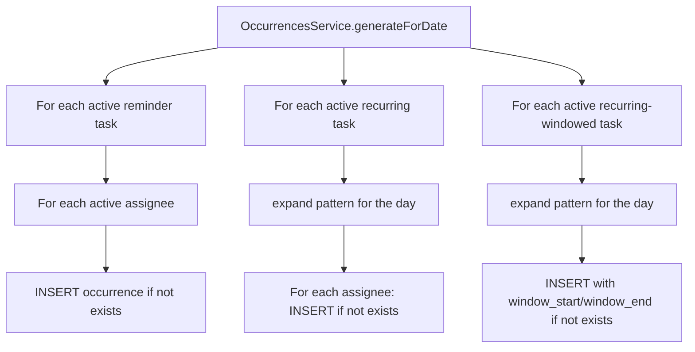

# Recurrence & occurrence generation

Tasks define a recurrence pattern; occurrences are concrete materializations of that pattern for a specific Trackee on a specific calendar day. Pattern expansion is a pure function; persistence is a service.

See also: [../../GLOSSARY.md](../../GLOSSARY.md) (task kinds), [miss-detection.md](miss-detection.md), [streaks.md](streaks.md), [../architecture/scheduling.md](../architecture/scheduling.md).

## Task kinds

`TaskEntity.kind` is the discriminator ([task.entity.ts](../../apps/api/src/tasks/task.entity.ts)):

| Kind | Deadline | Generates occurrences? | Has a Miss? |
| --- | --- | --- | --- |
| `reminder` | `due_time` | yes, one per day per assignee | no — auto-completes when its time passes |
| `recurring` | `due_time` (or midnight if unset) | yes, on each pattern hit | yes |
| `windowed` | `window_end` | yes; can be recurring (per-day window) or one-shot | yes, fires at `window_end`; no late completion |

## The pure recurrence engine

[apps/api/src/tasks/recurrence/engine.ts](../../apps/api/src/tasks/recurrence/engine.ts) exposes one entry:

```ts
expand(pattern: RecurrencePattern, range: DateRange): Occurrence[]
```

No DB, no DI, no `Clock` — just date math on the calendar fields of `Date`. The engine walks the range day-by-day and tests each day against the pattern.

### Supported patterns

Defined in [recurrence/types.ts](../../apps/api/src/tasks/recurrence/types.ts):

- `daily`
- `weekdays`, `weekends`
- `weekly { days }`
- `biweekly { days, anchor }`
- `every_n_days { n, anchor }`
- `every_n_weeks { n, days, anchor }`
- `every_n_months { n, day_of_month, anchor }`
- `yearly_on_date { month, day }`
- `yearly_in_month { month, ordinal, day_of_week }` — e.g., "2nd Tuesday of June"

`anchor` is an ISO `YYYY-MM-DD` that fixes the phase of the cadence (week A vs. week B for `biweekly`, the modulo class for `every_n_*`).

### Timezone posture

The engine is **timezone-agnostic**: it reads `getFullYear / getMonth / getDate` and `getDay` from `Date`, which return runtime-local calendar fields. Because of that, the **caller contract** (ADR-0007) is that the `range` Dates and `pattern.anchor` must encode the **household civil day**. The occurrence generator does this with `civilDayToken(date, tz)` — a `new Date(y, m, d)` built from the household `Y/M/D` — so the engine's reads yield the household date no matter what zone the API process runs in. Wall-clock time-of-day is anchored after expansion via `combineDateAndDueTime(date, due_time, tz)` (or the window offsets for windowed tasks).

This means DST transitions can shift the UTC instant of "midnight local" by an hour twice a year, but the engine always emits one hit per household calendar day for a daily task. Human expectation wins over UTC purity.

## When occurrences materialize

`OccurrencesService.generateForDate(date)` is the only producer:



`generateForDate` is **called from four places** and nowhere else:

1. **Module boot** ([tasks.module.ts](../../apps/api/src/tasks/tasks.module.ts)) — backfill "today" so the tablet has data immediately after a restart.
2. **Task CRUD endpoints** ([tasks.controller.ts:109,126,148,173,213,239](../../apps/api/src/tasks/tasks.controller.ts#L109)) — re-materialize today after any task create/update so the tablet picks the change up without a restart.
3. **One-shot windowed task create** — `OccurrencesService.createOneShotWindowedOccurrence` is called inline by the windowed-task POST handler using the absolute `window_start` / `window_end` the Admin supplied.
4. **Daily rollover timer** (`TasksModule.runDayRollover`, [tasks.module.ts](../../apps/api/src/tasks/tasks.module.ts)) — in the first few minutes after household-local midnight the rollover timer materializes the new day *before* rolling over the streak that just ended. This is what keeps a long-running process producing a fresh routine each day.

Before the rollover timer materialized the new day (it only rolled the streak), a long-running process left the tablet's routine **empty after midnight** until the next API restart or the next task save — the save path's `generateForDate(today)` was the only thing that backfilled the day. In normal use the API restarted often enough (CI image pulls, host reboots) to usually mask it, but a stable instance surfaced it. In `E2E_TEST_MODE` the production timers don't run; specs cross midnight via `/_e2e/clock/advance`, which itself calls `generateForDate` ([e2e.controller.ts](../../apps/api/src/e2e/e2e.controller.ts)), so the new day always materializes without driving the timer.

## Idempotency

`generateForDate` is safe to re-run. Every insert path queries for an existing occurrence with the same `(task_id, user_id, day)` first; duplicates are skipped. Reminder + recurring use `scheduled_at`-day windows; windowed uses `window_start`-day.

## Anchoring wall-clock time

The recurrence engine only emits calendar days. The service layer combines that with:

- **Reminder + recurring**: `combineDateAndDueTime(date, task.dueTime, tz)` — task's `due_time` (HH:MM) within the household time zone ([household-settings](../../apps/api/src/household-settings/) → `time_zone`). `tz` is always supplied; see ADR-0007.
- **Recurring windowed**: `window_start_offset_minutes` + `window_end_offset_minutes` measured from the household-local midnight of the hit date.
- **One-shot windowed**: absolute timestamps supplied by the Admin.

The household time zone defaults to `America/Los_Angeles` ([household-settings.entity.ts](../../apps/api/src/household-settings/household-settings.entity.ts)).

## Adding a new pattern

Add a variant to `RecurrencePattern` in [recurrence/types.ts](../../apps/api/src/tasks/recurrence/types.ts), then one more `case` to `expand()` in [recurrence/engine.ts](../../apps/api/src/tasks/recurrence/engine.ts). No other call sites should need to change — the service treats `expand()` as opaque.

## Files to read

- [apps/api/src/tasks/recurrence/types.ts](../../apps/api/src/tasks/recurrence/types.ts)
- [apps/api/src/tasks/recurrence/engine.ts](../../apps/api/src/tasks/recurrence/engine.ts)
- [apps/api/src/tasks/recurrence/engine.spec.ts](../../apps/api/src/tasks/recurrence/engine.spec.ts)
- [apps/api/src/tasks/occurrences.service.ts](../../apps/api/src/tasks/occurrences.service.ts)
- [apps/api/src/tasks/tasks.controller.ts](../../apps/api/src/tasks/tasks.controller.ts)
