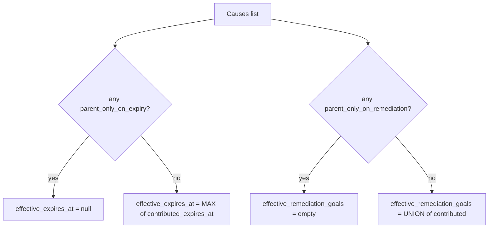
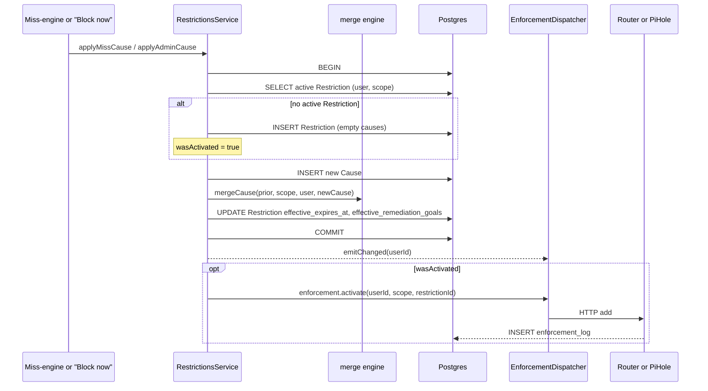
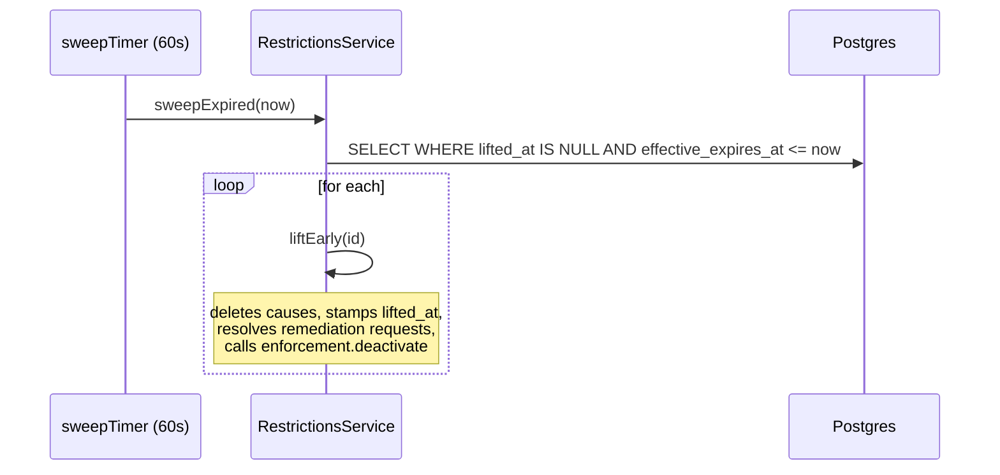

# Restrictions

A **Restriction** blocks one scope (`internet | entertainment | games`) for one Restrictable Trackee. It has 1+ **Causes**; its effective expiry and remediation options are *derived* from the cause list via a pure merge engine. Enforcement is dispatched per scope: `internet` → EdgeRouter, `entertainment`/`games` → PiHole.

See also: [../adr/0004-restrictions-have-orthogonal-lift-mechanisms.md](../adr/0004-restrictions-have-orthogonal-lift-mechanisms.md), [../adr/0006-restriction-enforcement-is-dispatched-per-scope.md](../adr/0006-restriction-enforcement-is-dispatched-per-scope.md), [../../GLOSSARY.md](../../GLOSSARY.md#restrictions), [miss-detection.md](miss-detection.md).

## Cause vs. Restriction

```
              Restriction (user_id, scope)
              ├── effective_expires_at        ← derived
              ├── effective_remediation_goals ← derived
              ├── lifted_at
              └── Causes [
                    MissCause   (occurrence_id, kind='miss',  contributed_*, parent_only_*)
                    AdminCause  (admin_user_id, kind='admin', null contributed,
                                 parent_only_on_expiry=true,
                                 parent_only_on_remediation=true)
                    …
                  ]
```

At most one active Restriction per `(user, scope)` — new causes merge into the existing record. The Restriction row stays after lift (for audit) with `lifted_at` set.

## Merge engine (pure)

Two orthogonal-lift rules, "most restrictive wins per dimension, independently":

- **`effective_expires_at` = MAX** of all causes' `contributed_expires_at`, OR `null` if any cause has `parent_only_on_expiry = true`.
- **`effective_remediation_goals` = UNION** of all causes' `contributed_remediation_goals`, OR `[]` if any cause has `parent_only_on_remediation = true`.



A Restriction with `effective_expires_at = null` AND empty remediation list is **parent-only in effect** — only an Admin lift unblocks it.

Code: [restriction-merge.ts:47](../../apps/api/src/restrictions/restriction-merge.ts#L47) (`recompute`, `mergeCause`, `removeCause`).

## Cause lifecycle



`applyCause` is the single entry — `applyMissCause` and `applyAdminCause` are thin shims that supply the right cause shape ([restrictions.service.ts:89-117](../../apps/api/src/restrictions/restrictions.service.ts#L89)). The enforcement activate is **only** called on first cause; subsequent causes on an already-active Restriction don't re-fire the adapter (the device is already in the deny set).

## Cause shapes

| Source | `kind` | `contributed_expires_at` | `contributed_remediation_goals` | `parent_only_on_expiry` | `parent_only_on_remediation` |
| --- | --- | --- | --- | --- | --- |
| Miss-engine, tier has `duration_minutes` only | `miss` | `now + duration_minutes` | null | false | true |
| Miss-engine, tier has `remediation_goal_ids` only | `miss` | null | array | true | false |
| Miss-engine, tier has both | `miss` | `now + duration_minutes` | array | false | false |
| Miss-engine, tier has neither | `miss` | null | null | true | true (parent-only) |
| Admin "Block now" | `admin` | null | null | **always true** | **always true** |

Code: [miss.service.ts:241-269](../../apps/api/src/tasks/miss.service.ts#L241), [restrictions.service.ts:106-117](../../apps/api/src/restrictions/restrictions.service.ts#L106).

## Lift mechanisms (ADR-0004)

Four orthogonal paths to remove a Restriction:

| Mechanism | Effect | Code |
| --- | --- | --- |
| Admin lift | `liftEarly(restrictionId)` — deletes all Causes, stamps `lifted_at`, resolves open remediation requests, deactivates enforcement | [restrictions.service.ts:152](../../apps/api/src/restrictions/restrictions.service.ts#L152) |
| Auto-expiry (wait-out) | 60s sweep finds Restrictions with `effective_expires_at <= now`, calls `liftEarly` on each | [restrictions.service.ts:124](../../apps/api/src/restrictions/restrictions.service.ts#L124) |
| Goal remediation | Trackee completes any goal in `effective_remediation_goals` — handled by the Goals module's completion path (calls back into RestrictionsService to remove matching cause(s)) | [goals/](../../apps/api/src/goals/) |
| Late completion of the originating Miss | `removeCausesByOccurrence(occ.id)` — deletes any MissCause whose `occurrence_id` matches, recomputes; lifts if cause list goes empty | [restrictions.service.ts:196](../../apps/api/src/restrictions/restrictions.service.ts#L196) |

A Restriction's enforcement deactivates **only when the Restriction lifts**, not when any one cause leaves. The Cause list shrinking doesn't unblock the network — only the merged "no more causes" state does.

## Wait-out sweep



Code: [restrictions.module.ts:167](../../apps/api/src/restrictions/restrictions.module.ts#L167), [restrictions.service.ts:124](../../apps/api/src/restrictions/restrictions.service.ts#L124).

## Enforcement dispatch (ADR-0006)

`RestrictionEnforcementService` is a pure dispatcher — scope → backend, fixed at boot:

```
internet      → router  (EdgeRouter HTTP ipset)
entertainment → pihole  (DNS blocklist group)
games         → pihole  (DNS blocklist group)
```

Code: [restriction-enforcement.service.ts:35-39](../../apps/api/src/restrictions/restriction-enforcement.service.ts#L35). The dispatcher itself has no logic beyond mapping; it forwards `activate / deactivate(userId, scope, restrictionId)` to the right backend.

### Router backend (`internet`)

[router-enforcement.service.ts](../../apps/api/src/restrictions/router-enforcement.service.ts). One batched HTTP call per `(user, scope)` containing every Device IP in CSV form. Targets the EdgeRouter's HTTP daemon. Bearer token auth.

### PiHole backend (`entertainment`, `games`)

[pihole-enforcement.service.ts](../../apps/api/src/restrictions/pihole-enforcement.service.ts). Per-Device read-modify-write on the PiHole group membership for the MAC address. The group names default to `blocked-games-dynamic` and `blocked-streaming-dynamic`; override with `PIHOLE_GAMES_GROUP_NAME` / `PIHOLE_STREAMING_GROUP_NAME`. Missing group names at boot are a hard error (the service throws in `onModuleInit`).

### Logging

Every adapter call writes one row to `enforcement_log` ([enforcement-log.entity.ts](../../apps/api/src/restrictions/enforcement-log.entity.ts)):

- `backend` ∈ `{router, pihole}`
- `action` ∈ `{add, del}`
- `result` ∈ `{ok, error, skipped}` (skipped = Trackee has no Device with the relevant address kind)
- `http_status`, `error`, `target_address` for forensics

The admin dashboard renders the last 100 entries via `RestrictionEnforcementService.recentLog`.

### Failure handling

Adapters are **fire-and-forget**: a failed HTTP call logs `result='error'` but does **not** roll back the in-app Restriction state. The reasoning: the cause-driven in-app state is the household's source of truth; an unreachable router or PiHole is an operator problem to fix, not a reason to refuse to register the block. The wait-out sweep will retry the deactivate naturally if the next sweep finds the Restriction still expired.

## Remediation requests

When a Trackee asks the Admin to lift a Restriction (via the tablet), a `remediation_requests` row is created with `status='open'`. Lifting the Restriction by any path auto-resolves open requests via `UPDATE remediation_requests SET status='resolved' WHERE restriction_id=? AND status='open'`. Code: [restrictions.service.ts:175-180](../../apps/api/src/restrictions/restrictions.service.ts#L175), [259-287](../../apps/api/src/restrictions/restrictions.service.ts#L259).

## Edge cases

- **Non-Restrictable Trackee + tier with restriction spec**: ladder still advances, penalty still posts, restriction cause is **silently skipped** in the Miss-engine (`isRestrictable` gates the cause emit at [miss.service.ts:241](../../apps/api/src/tasks/miss.service.ts#L241)).
- **Trackee with no Device of the required address kind**: the Restriction row exists in-app; the adapter writes `result='skipped'`; the admin UI flags it as "NOT ENFORCED".
- **Multiple MissCauses on same Restriction**: each contributes independently; the merge MAX/UNION rule combines them. Late-completing one Miss removes just that Cause; the others persist.
- **Lift while sweep is mid-flight**: idempotent — `liftEarly` is keyed on `lifted_at IS NULL`; second call no-ops via the NotFoundException path.

## Files to read

- [apps/api/src/restrictions/restriction-merge.ts](../../apps/api/src/restrictions/restriction-merge.ts) (+ [.spec.ts](../../apps/api/src/restrictions/restriction-merge.spec.ts))
- [apps/api/src/restrictions/restrictions.service.ts](../../apps/api/src/restrictions/restrictions.service.ts)
- [apps/api/src/restrictions/restriction-enforcement.service.ts](../../apps/api/src/restrictions/restriction-enforcement.service.ts) (+ [.spec.ts](../../apps/api/src/restrictions/restriction-enforcement.service.spec.ts))
- [apps/api/src/restrictions/router-enforcement.service.ts](../../apps/api/src/restrictions/router-enforcement.service.ts) (+ [.spec.ts](../../apps/api/src/restrictions/router-enforcement.service.spec.ts))
- [apps/api/src/restrictions/pihole-enforcement.service.ts](../../apps/api/src/restrictions/pihole-enforcement.service.ts) (+ [.spec.ts](../../apps/api/src/restrictions/pihole-enforcement.service.spec.ts))
- [apps/api/src/restrictions/restrictions.module.ts](../../apps/api/src/restrictions/restrictions.module.ts)
- [apps/api/src/restrictions/enforcement-log.entity.ts](../../apps/api/src/restrictions/enforcement-log.entity.ts)
