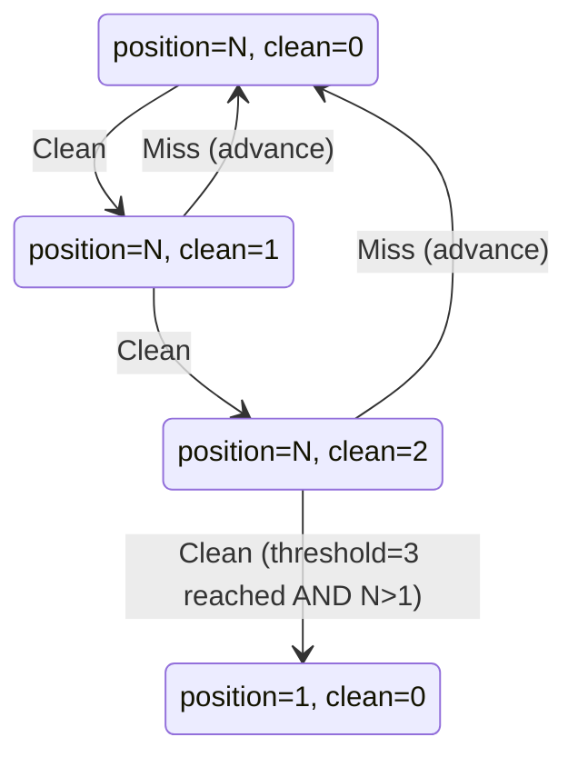

# Streaks

Two streak concepts that share a name root but mean different things:

- **Daily routine streak** — per Trackee, household-wide qualifying day counter. Drives the *daily bonus reward*.
- **Clean streak** — per (Task × Trackee), Clean-occurrence counter. Drives the *ladder reset* (which lifts a *penalty pressure*).

See also: [../../GLOSSARY.md](../../GLOSSARY.md#daily-routine-streak), [miss-detection.md](miss-detection.md), [presence.md](presence.md).

## Daily routine streak

A per-Trackee counter that increments on each qualifying day, resets to 0 on a break, and preserves through non-event days.

### Day classification

`classifyDay(occurrencesForDay)` ([daily-streak-engine.ts:64](../../apps/api/src/tasks/daily-streak-engine.ts#L64)) returns one of:

| Class | Trigger | Counter effect | Bonus |
| --- | --- | --- | --- |
| `break` | Any non-reminder occurrence that isn't excused/deferred/suppressed has status `active` or `missed` at rollover | count → 0; `last_qualifying_day` preserved | none |
| `advance` | ≥1 non-reminder occurrence scheduled AND every non-reminder, non-suppressed occurrence is `complete`/`pending_review`/`excused`/`deferred` | count += 1; `last_qualifying_day = day` | bonus earn (default 5) |
| `non-event` | No non-reminder occurrences scheduled OR all of them are excused/deferred/suppressed | count and `last_qualifying_day` preserved | none |

Reminders are ignored entirely — they're informational, not bound to a deadline.

### Day rollover

```mermaid
sequenceDiagram
  participant T as rolloverTimer (60s)
  participant DS as DailyStreakService
  participant DB as Postgres

  T->>DS: rolloverDay(yesterday)
  Note over T: only inside the first 5 min after household-local midnight; "yesterday" + the per-day occurrence query are bucketed in the household zone (ADR-0007)
  loop for each active Trackee
    DS->>DB: SELECT occurrences for user × yesterday
    DS->>DS: classifyDay(occs)
    DS->>DS: applyDay(priorState, classification)
    DS->>DB: UPSERT daily_streaks (count, last_qualifying_day)
    alt classification === 'advance'
      DS->>DB: INSERT transaction (earn, +bonusAmount, reason='daily routine streak')
    end
  end
```

Code: [daily-streak.service.ts:37](../../apps/api/src/tasks/daily-streak.service.ts#L37).

### Windowed occurrences and the streak day

Windowed occurrences land on the day of their `window_end`, not `scheduled_at` (`scheduled_at` carries `window_start`). The rollover query selects them via `OR (window_end BETWEEN dayStart AND dayEnd)` ([daily-streak.service.ts:108-117](../../apps/api/src/tasks/daily-streak.service.ts#L108)).

### Bonus amount

`bonusAmount` is read per-household from `household_settings.daily_bonus_amount` (admin-editable on the Household settings screen), defaulting to 5 ([household-settings.service.ts](../../apps/api/src/household-settings/household-settings.service.ts) `DEFAULT_DAILY_BONUS`). Both the day-rollover sweep ([daily-streak.service.ts](../../apps/api/src/tasks/daily-streak.service.ts)) and the presence-reconciliation recompute ([presence-reconciliation.service.ts](../../apps/api/src/presence/presence-reconciliation.service.ts)) source it from there. Setting it to 0 disables bonus payments while still maintaining the counter.

### Late-completion fix-up

If a Miss-broken day is late-completed *after* the rollover already classified the day as `break`, the rollover already wrote `count = 0`. The late-completion path repairs it for the simple single-break case:

```ts
if (wasBrokenDayPast) {
  streak.count = streak.count + 1;
  streak.lastQualifyingDay = max(streak.lastQualifyingDay, occ-day);
}
```

[occurrence-actions.service.ts:237-249](../../apps/api/src/tasks/occurrence-actions.service.ts#L237). Multi-day reconciliation isn't attempted — per ADR-0001 the disincentive for a Miss is the temp access loss, not exhaustive ledger replay.

## Clean streak (per Task × Trackee)

Tracks consecutive Clean occurrences of one task after its most recent Miss-with-advance. When it reaches `task.ladder_reset_threshold` (default 3), the ladder position resets to 1.

### Counter semantics

`LadderPositionEntity.clean_streak_count`:

- On `recordClean(occurrence)` ([miss.service.ts:138](../../apps/api/src/tasks/miss.service.ts#L138)) — increments. If the next count meets `ladder_reset_threshold` AND `position > 1`, both are reset (`position = 1`, `clean_streak_count = 0`).
- On Miss (`applyMissOutcome`) — `clean_streak_count = 0`, `position = next_tier`.
- On late completion — `clean_streak_count` not touched directly; the post-undo state is "as if the Miss never fired".
- Excused / Deferred / Presence-suppressed occurrences neither advance nor reset the count.

### When does a Clean occurrence count?

Only completion paths that aren't pending-review:

- `markComplete` on a task with `requires_verification === false` → `recordClean(occ)` immediately ([occurrences.service.ts:361](../../apps/api/src/tasks/occurrences.service.ts#L361)).
- Pending-review **approve** → `recordClean(occ)` ([pending-review.service.ts:88](../../apps/api/src/pending-review/pending-review.service.ts#L88)).
- Late completion — flips the occurrence back to `complete`; the next rollover reads it as positive, but the Clean counter is incremented as part of the undo path implicitly via the ladder retract.

### Reset rule



Code: [miss.service.ts:163-170](../../apps/api/src/tasks/miss.service.ts#L163).

## Files to read

- [apps/api/src/tasks/daily-streak-engine.ts](../../apps/api/src/tasks/daily-streak-engine.ts) (pure engine)
- [apps/api/src/tasks/daily-streak-engine.spec.ts](../../apps/api/src/tasks/daily-streak-engine.spec.ts)
- [apps/api/src/tasks/daily-streak.service.ts](../../apps/api/src/tasks/daily-streak.service.ts)
- [apps/api/src/tasks/daily-streak.entity.ts](../../apps/api/src/tasks/daily-streak.entity.ts)
- [apps/api/src/tasks/ladder-position.entity.ts](../../apps/api/src/tasks/ladder-position.entity.ts)
- [apps/api/src/tasks/miss.service.ts](../../apps/api/src/tasks/miss.service.ts) (`recordClean`)
